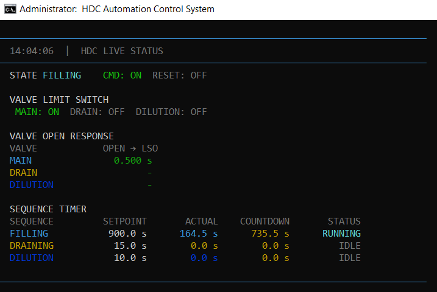
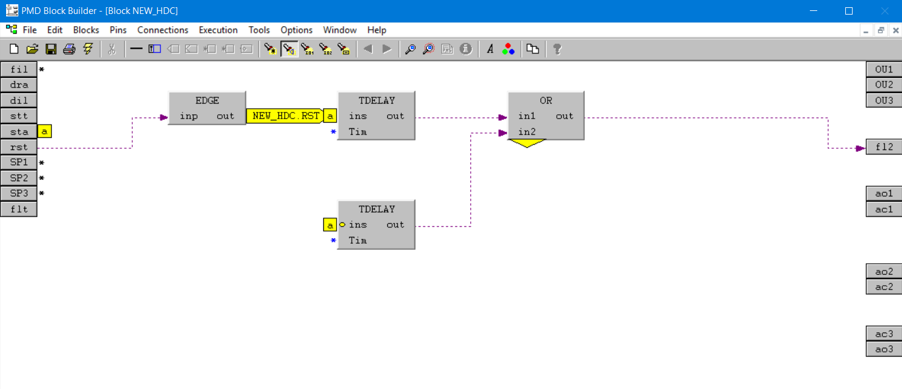
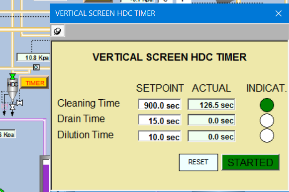

# 🧹 HDC Automation Control System

> **Automatic High Density Cleaner sequence controller untuk Honeywell DCS melalui OPC DA**
>
> Dibangun untuk kebutuhan otomasi sequence HDC pada lingkungan **industrial process / paper manufacturing**, dengan Python sebagai sequence controller dan Honeywell DCS sebagai process-side interface.

<p align="center">
  <strong>🐍 Python</strong> · <strong>⚙️ OPC DA</strong> · <strong>🏭 Honeywell DCS</strong> · <strong>🛡️ Interlock</strong> · <strong>💓 Watchdog</strong>
</p>

---

## 📌 Tentang Project

Project ini adalah aplikasi otomasi **High Density Cleaner (HDC)** yang mengintegrasikan Python dengan **Honeywell DCS melalui OPC DA / COM**.

Aplikasi menangani sequence otomatis:

```text
START
  │
  ▼
FILLING
  │
  ▼
DRAINING
  │
  ▼
DILUTION
  │
  └───────────────▶ FILLING ...
```

Di dalamnya terdapat **state machine**, interlock, monitoring limit switch, sequence timer, valve response-time measurement, fault handling, OPC reconnect, COM cleanup, serta heartbeat dari Python ke DCS.

Project ini dikembangkan secara iteratif dari kebutuhan troubleshooting dan improvement sistem HDC nyata. Fokus utamanya bukan hanya membuat sequence berjalan, tetapi membuat program lebih mudah **dimonitor, di-debug, dipelihara, dan dipersiapkan untuk operasi jangka panjang**.

---

## ✨ Fitur Utama

- 🔄 **Automatic HDC sequence**
  - Filling
  - Draining
  - Dilution
  - Continuous cycle selama START aktif
- 🎛️ **Single START command**
  - `NEW_HDC.STT = 1` → START / RUN
  - `NEW_HDC.STT = 0` → STOP
- ♻️ **Reset command**
  - `NEW_HDC.RST = 1` → reset fault yang ter-latch
- 🛡️ **Valve interlock & limit-switch confirmation**
- ⏱️ **Valve OPEN response-time measurement**
  - Mengukur waktu dari command OPEN sampai `LSO = 1`
- ⏳ **Actual sequence timer**
  - `OU1` → actual elapsed time Filling
  - `OU2` → actual elapsed time Draining
  - `OU3` → actual elapsed time Dilution
- 🚨 **DCS fault indication**
  - `NEW_HDC.FLT = 1` ketika HDC masuk FAULT
- 💓 **Python heartbeat / watchdog**
  - `NEW_HDC.STA` toggle secara periodik selama main loop hidup
  - DCS dapat mendeteksi Python berhenti/hang melalui timeout heartbeat
- 🔌 **OPC DA auto reconnect**
  - Reconnect setelah kegagalan read/write/connection
  - OPC Group dan Items dibuat kembali setelah reconnect
- 🧹 **COM cleanup**
  - Explicit release/disconnect OPC/COM saat reconnect dan shutdown
- 🖥️ **Live color console dashboard**
  - Status diperbarui di layar yang sama, tidak terus scrolling
  - Informasi inisialisasi tetap terlihat
- 🚫 **Tanpa runtime `.log` file**
  - Output operasional ditujukan ke console

---

## 🧠 Arsitektur

```text
┌─────────────────────────────────────────────────────────────┐
│                    HDC AUTOMATION APP                      │
│                                                             │
│  ┌─────────────┐    ┌────────────────┐    ┌─────────────┐ │
│  │ main.py     │───▶│ HDCSequence    │───▶│ Interlocks  │ │
│  │ Main Loop   │    │ State Machine  │    │ / Safety    │ │
│  └──────┬──────┘    └───────┬────────┘    └─────────────┘ │
│         │                    │                              │
│         ▼                    ▼                              │
│  ┌──────────────────────────────────────────────────────┐  │
│  │                 OPCClient / win32com                 │  │
│  │        Read / Write / Reconnect / COM Cleanup        │  │
│  └──────────────────────────┬───────────────────────────┘  │
└─────────────────────────────┼──────────────────────────────┘
                              │ OPC DA / COM
                              ▼
                    ┌────────────────────┐
                    │ Honeywell DCS      │
                    │ PMD OPC Server     │
                    └────────────────────┘
```

### Alur runtime

```text
DCS command
    │
    ▼
OPC DA Read
    │
    ▼
HDC State Machine
    │
    ├── Valve command ──────▶ DCS
    │
    ├── LSO feedback ◀────── DCS
    │
    ├── Sequence timer ─────▶ OU1 / OU2 / OU3
    │
    └── Fault ──────────────▶ FLT

Python main loop ───────────▶ STA heartbeat
```

---

# 📸 Dokumentasi Visual

Bagian ini menunjukkan tiga layer utama dari implementasi HDC: **Python runtime**, **logic Honeywell DCS**, dan **operator HMI**.

## 1. 🖥️ Python Live Console

Console memberikan monitoring realtime terhadap state HDC, command, limit switch, response time valve, serta timer sequence.

<p align="center">
  
</p>

Informasi yang ditampilkan:

- Current state: `FILLING`, `DRAINING`, `DILUTION`, `FAULT`, dll.
- Status START/STOP dan RESET
- Feedback limit switch valve
- Waktu aktual OPEN → LSO
- Setpoint sequence
- Actual elapsed time
- Countdown sequence

Console sengaja menggunakan konsep **live dashboard**, sehingga status yang berubah setiap cycle tidak terus memenuhi terminal.

---

## 2. ⚙️ Honeywell DCS / PMD Block Builder

Logic DCS menjadi interface process-side untuk timer, reset, indication, dan signal HDC yang berkomunikasi dengan Python melalui OPC DA.

<p align="center">
  
</p>

Screenshot ini mendokumentasikan salah satu bagian logic `NEW_HDC` yang digunakan bersama controller Python.

---

## 3. 🎛️ Operator HMI — Vertical Screen HDC Timer

HMI digunakan operator untuk melihat setpoint dan actual cleaning time, drain time, dilution time, indication sequence, RESET, serta status STARTED.

<p align="center">
  
</p>

> **Catatan:** nilai pada screenshot merupakan nilai runtime dari implementasi dan digunakan untuk mendokumentasikan interface serta perilaku sequence.

---

# 🗂️ Struktur Project

```text
HDC/
├── config/
│   ├── __init__.py
│   ├── settings.py          # Konfigurasi OPC, timing, watchdog
│   └── tags.py              # Mapping tag DCS
│
├── opc/
│   ├── __init__.py
│   └── client.py            # OPC DA read/write/reconnect/COM cleanup
│
├── safety/
│   ├── __init__.py
│   ├── interlock.py         # Interlock valve / auto mode
│   └── program_safety.py    # Interface heartbeat STA
│
├── sequence/
│   ├── __init__.py
│   └── hdc_sequence.py      # State machine dan sequence HDC
│
├── utils/
│   ├── __init__.py
│   └── logger.py             # Live colored console dashboard
│
├── docs/
│   └── images/
│       ├── console.png
│       ├── dsc_logic.png
│       └── hmi.png
│
├── main.py                   # Entry point
├── start_hdc.bat             # Launcher Windows menggunakan _env
├── requirements.txt
├── .gitignore
└── README.md
```

---

# 🧰 Requirements

## Operating System

- Windows 10/11 atau Windows Server yang sesuai dengan environment Honeywell OPC DA
- Python 3.x
- Akses ke Honeywell OPC DA Server melalui Windows COM/DCOM

## Python packages

Dependency runtime yang digunakan project saat ini:

```text
colorama==0.4.6
pywin32==312
```

`OpenOPC-DA`, `comtypes`, `numpy`, dan `pandas` **tidak lagi diperlukan** oleh implementasi saat ini karena project menggunakan `win32com` / `pywin32` secara langsung.

---

# 🚀 Instalasi

Clone repository pada PC Windows yang mempunyai akses ke Honeywell OPC DA Server:

```powershell
git clone <URL_REPOSITORY_ANDA>
cd HDC
```

Buat virtual environment di dalam project:

```powershell
python -m venv _env
```

Aktifkan:

```powershell
_env\Scripts\activate
```

Install dependency:

```powershell
python -m pip install --upgrade pip
pip install -r requirements.txt
```

Test `pywin32`:

```powershell
python -c "import win32com.client, pythoncom; print('pywin32 OK')"
```

> `_env/` sengaja tidak masuk Git. Setiap PC deployment membuat environment sendiri.

---

# ⚙️ Konfigurasi

Edit `config/settings.py` sesuai environment OPC target:

```python
OPC_SERVER_NAME = "PMD.DDT_OPCDataServer.1"
OPC_GROUP_NAME = "PDPM11OPCGroup"
OPC_UPDATE_RATE = 500

LOOP_INTERVAL = 0.5
ENABLE_WRITE = True

VALVE_OPEN_TIMEOUT = 10.0

PROGRAM_HEARTBEAT_INTERVAL = 1.0
PROGRAM_WATCHDOG_TIMEOUT = 3.0
```

### ⚠️ Perhatian `ENABLE_WRITE`

```python
ENABLE_WRITE = True
```

berarti Python dapat mengirim command ke DCS.

Saat development/offline testing, gunakan:

```python
ENABLE_WRITE = False
```

sampai environment OPC dan logic DCS benar-benar sudah diverifikasi.

---

# 🔌 DCS Tag Mapping

Mapping utama berada di `config/tags.py`.

## Setpoint

| Fungsi        | DCS Tag         | Tipe |
| ------------- | --------------- | ---- |
| Filling time  | `NEW_HDC.SP1` | REAL |
| Draining time | `NEW_HDC.SP2` | REAL |
| Dilution time | `NEW_HDC.SP3` | REAL |

## Command

| Fungsi       | DCS Tag         | Arah          |
| ------------ | --------------- | ------------- |
| Start / Stop | `NEW_HDC.STT` | DCS → Python |
| Reset        | `NEW_HDC.RST` | DCS → Python |

`STT` adalah **single level command**:

```text
1 = START / RUN
0 = STOP
```

## Actual sequence timer

| Sequence                     | DCS Tag         | Tipe           |
| ---------------------------- | --------------- | -------------- |
| Filling actual elapsed time  | `NEW_HDC.OU1` | REAL / seconds |
| Draining actual elapsed time | `NEW_HDC.OU2` | REAL / seconds |
| Dilution actual elapsed time | `NEW_HDC.OU3` | REAL / seconds |

Hanya sequence aktif yang melaporkan actual timer non-zero.

## Sequence indication

| Sequence | DCS Tag         |
| -------- | --------------- |
| Filling  | `NEW_HDC.FIL` |
| Draining | `NEW_HDC.DRA` |
| Dilution | `NEW_HDC.DIL` |

## Valve command & feedback

| Fungsi               | DCS Tag               |
| -------------------- | --------------------- |
| Main valve OPEN      | `NEW_HDC.AO1`       |
| Drain valve OPEN     | `NEW_HDC.AO2`       |
| Dilution valve OPEN  | `NEW_HDC.AO3`       |
| Main valve CLOSE     | `NEW_HDC.AC1`       |
| Drain valve CLOSE    | `NEW_HDC.AC2`       |
| Dilution valve CLOSE | `NEW_HDC.AC3`       |
| Main valve LSO       | `NEW_HDC_MAIN.LSO`  |
| Drain valve LSO      | `NEW_HDC_DRAIN.LSO` |
| Dilution valve LSO   | `NEW_HDC_DILL.LSO`  |

## Safety signal

| Fungsi           | DCS Tag         | Arti                          |
| ---------------- | --------------- | ----------------------------- |
| Python heartbeat | `NEW_HDC.STA` | Toggle`0/1` secara periodik |
| HDC fault        | `NEW_HDC.FLT` | `0 = normal`, `1 = fault` |

`NEW_HDC.INF` **sudah tidak digunakan** oleh aplikasi.

---

# 💓 Watchdog Concept

`NEW_HDC.STA` merupakan heartbeat yang dihasilkan Python:

```text
Python main loop
      │
      ├── STA = 0
      ├── STA = 1
      ├── STA = 0
      ├── STA = 1
      └── ...
```

Default:

```text
Heartbeat interval : 1 second
DCS timeout        : 3 seconds
```

Arsitektur yang direkomendasikan adalah **DCS yang mengambil keputusan watchdog**. Jika `STA` tidak berubah dalam timeout yang ditentukan, DCS dapat menganggap aplikasi Python tidak tersedia dan menjalankan tindakan fail-safe yang sudah disetujui di plant.

Python bukan final safety layer. Tindakan safety harus divalidasi terhadap machine, DCS logic, interlock, dan standard keselamatan site.

---

# 🔄 OPC Reconnect & COM Cleanup

Dalam kondisi normal, OPC object dipertahankan dan digunakan ulang. Program **tidak membuat OPC object baru setiap main-loop cycle**.

Jika terjadi kegagalan OPC:

```text
OPC failure
    ↓
Mark connection unavailable
    ↓
Release OPC Item / Group / Server references
    ↓
Disconnect OPC server
    ↓
Uninitialize COM
    ↓
Initialize COM kembali
    ↓
Connect
    ↓
Recreate OPC Group / Items
    ↓
Resume operation
```

Tujuannya adalah mengurangi risiko object COM tertinggal selama operasi jangka panjang.

---

# ⏱️ Timer & Valve Response

Project membedakan dua jenis pengukuran waktu.

### Sequence timer

```text
Setpoint
   │
   ▼
Actual elapsed time ───────▶ OU1 / OU2 / OU3
   │
   ▼
Countdown = Setpoint - Actual
```

### Valve response time

```text
OPEN command
     │
     │ timer start
     ▼
Valve bergerak
     │
     ▼
LSO = 1
     │
     │ timer stop
     ▼
Actual OPEN → LSO response time
```

Contoh console:

```text
VALVE OPEN RESPONSE
VALVE            OPEN → LSO
MAIN               0.516 s
DRAIN                    -
DILUTION                 -
```

Ini membantu troubleshooting ketika valve secara proses terasa lambat atau limit switch tidak segera aktif.

---

# 🖥️ Live Console Dashboard

Console dirancang sebagai **live dashboard**, bukan scrolling log.

Contoh:

```text
──────────────────────────────────────────────────────────────────────────────
  14:04:06  |  HDC LIVE STATUS
──────────────────────────────────────────────────────────────────────────────
  STATE FILLING    CMD: ON  RESET: OFF

  VALVE LIMIT SWITCH
   MAIN: ON  DRAIN: OFF  DILUTION: OFF

  VALVE OPEN RESPONSE
  VALVE            OPEN → LSO
  MAIN               0.500 s
  DRAIN                    -
  DILUTION                 -

  SEQUENCE TIMER
  SEQUENCE         SETPOINT       ACTUAL    COUNTDOWN       STATUS
  FILLING           900.0 s       164.5 s      735.5 s      RUNNING
  DRAINING           15.0 s         0.0 s        0.0 s         IDLE
  DILUTION           10.0 s         0.0 s        0.0 s         IDLE
──────────────────────────────────────────────────────────────────────────────
```

Layar diperbarui di tempat yang sama agar status realtime tidak terus memenuhi scrollback terminal.

---

# ▶️ Menjalankan Secara Manual

Cara paling mudah di Windows:

```text
start_hdc.bat
```

Launcher akan:

1. Masuk ke folder project.
2. Memastikan `_env` tersedia.
3. Menggunakan Python dari `_env`.
4. Menjalankan `main.py`.
5. Mempertahankan console setelah aplikasi berhenti agar error dapat dibaca.

Alternatif:

```powershell
_env\Scripts\python.exe main.py
```

---

# 🕐Windows Task Scheduler

Untuk PC industrial yang harus menjalankan HDC otomatis setelah login Administrator, gunakan Windows Task Scheduler.

Rekomendasi:

```text
Trigger : At log on
User    : Administrator
```

Options:

```text
Run only when user is logged on
Run with highest privileges
```

Action:

```text
Program/script:
D:\HDC\start_hdc.bat

Start in:
D:\HDC
```

Sesuaikan path dengan lokasi deployment.

`Run only when user is logged on` dipilih karena console HDC memang ingin ditampilkan kepada operator.

---

# 🧪 Catatan Development & Troubleshooting

## OPC DA

Project ini menggunakan **OPC DA / COM pada Windows**, bukan OPC UA.

Interface yang digunakan:

```text
OPC.Automation.1
```

Nama OPC server dan namespace tag bersifat spesifik terhadap environment DCS.

## OPC Value vs Quality

Saat troubleshooting, perlu diingat bahwa OPC DA mempunyai field **Value**, **Quality**, dan **Timestamp**.

Nilai:

```text
192 decimal = 0xC0
```

umumnya merupakan `OPC_QUALITY_GOOD`, sehingga **192 bukan berarti setpoint 192 detik** jika angka tersebut berasal dari field Quality.

Versi project ini membaca Value, Quality, dan Timestamp secara terpisah untuk menghindari kesalahan tersebut.

---

# 🤖 Dibangun Bersama ChatGPT

> **Coding credit: ChatGPT × Samuel Beryl Enrico Ritonga**

Project ini merupakan hasil pengembangan **human + AI collaboration**. ChatGPT digunakan sebagai **coding assistant / engineering copilot** selama proses development, troubleshooting, refactoring, dokumentasi, dan improvement program.

### Peran ChatGPT dalam pengerjaan

Beberapa pekerjaan yang dibantu melalui proses iteratif bersama ChatGPT antara lain:

- 🧩 Mendesain dan merapikan **HDC state machine**
- 🔄 Mengubah command menjadi single `STT`:
  - `1 = START`
  - `0 = STOP`
- 🔌 Migrasi dan troubleshooting integrasi **OPC DA menggunakan `win32com` / `pywin32`**
- 🛠️ Troubleshooting pembacaan OPC `Value / Quality / Timestamp`
- ⏱️ Implementasi actual timer dan countdown `OU1 / OU2 / OU3`
- 🚦 Implementasi monitoring limit switch
- 📏 Pengukuran response time `OPEN → LSO`
- 🚨 Implementasi centralized fault signal `NEW_HDC.FLT`
- 💓 Implementasi heartbeat `NEW_HDC.STA` sebagai interface watchdog Python → DCS
- 🔄 Perancangan OPC auto-reconnect
- 🧹 COM cleanup untuk operasi jangka panjang
- 🖥️ Perancangan live colored console dashboard
- 🚀 Pembuatan launcher `start_hdc.bat`
- 🪟 Dokumentasi Windows Task Scheduler
- 📚 Penyusunan dokumentasi dan README project
- 🐛 Analisis error runtime berdasarkan output console dan behavior sistem

### Cara kolaborasinya

Pengembangan dilakukan dengan pola:

```text
Engineering Problem
       │
       ▼
Observasi dari DCS / HMI / Console
       │
       ▼
Diskusi & analisis bersama ChatGPT
       │
       ▼
Modifikasi source code
       │
       ▼
Test / compile / commissioning
       │
       ▼
Temuan baru
       │
       └──────────────▶ Iterasi berikutnya
```

ChatGPT membantu pada sisi **reasoning, coding, refactoring, debugging, dan dokumentasi**, sementara keputusan engineering, konfigurasi DCS, pengujian di equipment, validasi interlock, dan penerapan di plant tetap berada pada engineer/operator yang bertanggung jawab.

Dengan kata lain:

> **AI membantu menulis dan memikirkan kode. Engineer tetap memegang kendali terhadap sistem nyata.**

---

-

# 👨‍💻 Author

**Samuel Beryl Enrico Ritonga**
Electrical, Automation & Instrumentation Engineer

### Built with

```text
Python
   +
pywin32 / win32com
   +
OPC DA
   +
Honeywell DCS
   +
Engineering Troubleshooting
   +
ChatGPT 🤖
```

---

<p align="center">
  <sub>Designed, engineered, tested, and iterated for real-world industrial automation.</sub>
</p>
